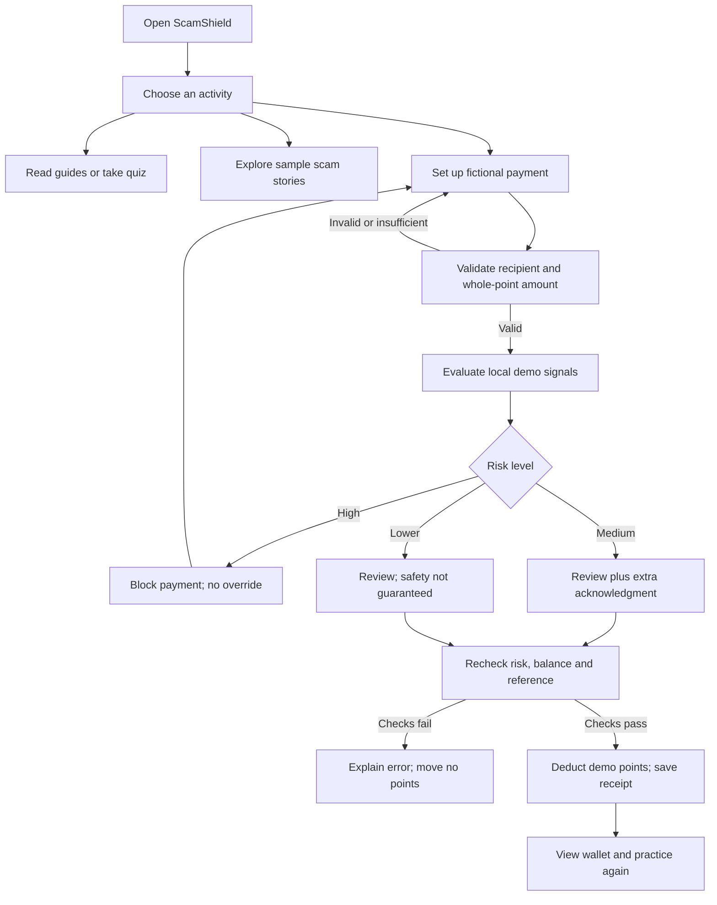

# Architecture and flow

The Android Activity hosts an entirely bundled web interface. It intercepts an HTTPS local origin and serves four allowlisted asset files. It blocks every other resource request and external navigation. There are no network permissions or JavaScript native bridges.

## Implementation map

- `engine.js`: Pure rules and immutable transfer operation. CommonJS export for Node tests; browser global for the interface.
- `app.js`: Views, routing, scenarios, quiz, local storage and UI events. All user text is escaped before HTML rendering.
- `styles.css`: Offline system fonts, phone and desktop layouts, focus states and reduced-motion support.
- `MainActivity.java`: A WebView restricted to a fixed HTTPS origin and a four-file asset allowlist. `shouldInterceptRequest` returns only packaged asset content; unknown resources receive 403. No network request is needed.

## Data and state

State schema version 1 contains `balance`, `receipts`, `reports`, `learned`, and `quizCompleted`. The initial balance is 1,000 points. Every saved receipt has a unique reference, fictional recipient ID, positive integer amount, lower/medium assessment and timestamp. Balance plus all spent points must equal 1,000.

Payment text, selected clues and the current draft reference are held in memory. They are not persisted in the receipt. A transaction can proceed only after review, valid amount, sufficient balance, a unique reference and a freshly recomputed non-high assessment. Medium risk also requires an additional UI acknowledgment. A disabled Send control plus synchronous state update and duplicate-reference validation prevent repeated taps from charging twice.

The implementation reads the current local state before mutation and observes storage changes from other tabs. Local storage provides no cross-tab transaction lock; simultaneous tabs are not supported for concurrent payments. This is explicitly a single-device educational simulation.

## Risk model

| Signal | Points |
| --- | ---: |
| Profile under 30 fictional days old | 15 |
| One or two sample reports, or a local report | 15 |
| Three or more sample reports | 35 |
| Simulated name mismatch | 35 |
| Urgency | 22 |
| Threat | 32 |
| Guaranteed return or reward | 28 |
| Secrecy | 30 |
| Unusual payment or sensitive access | 30 |

Each clue appears once even when both selected and detected in text. Score is capped at 100. Lower risk is below 25, medium is 25–59, and high is 60 or greater. Scores are illustrative weights, never fraud probabilities. The interface shows reasons instead of a confidence percentage.

All sample recipient fields are invented. Keyword matching is intentionally explainable but has no semantic understanding: quoting or negating a warning phrase may still trigger it, and a cleverly worded scam may not trigger it. The user interface consistently explains these limits.
